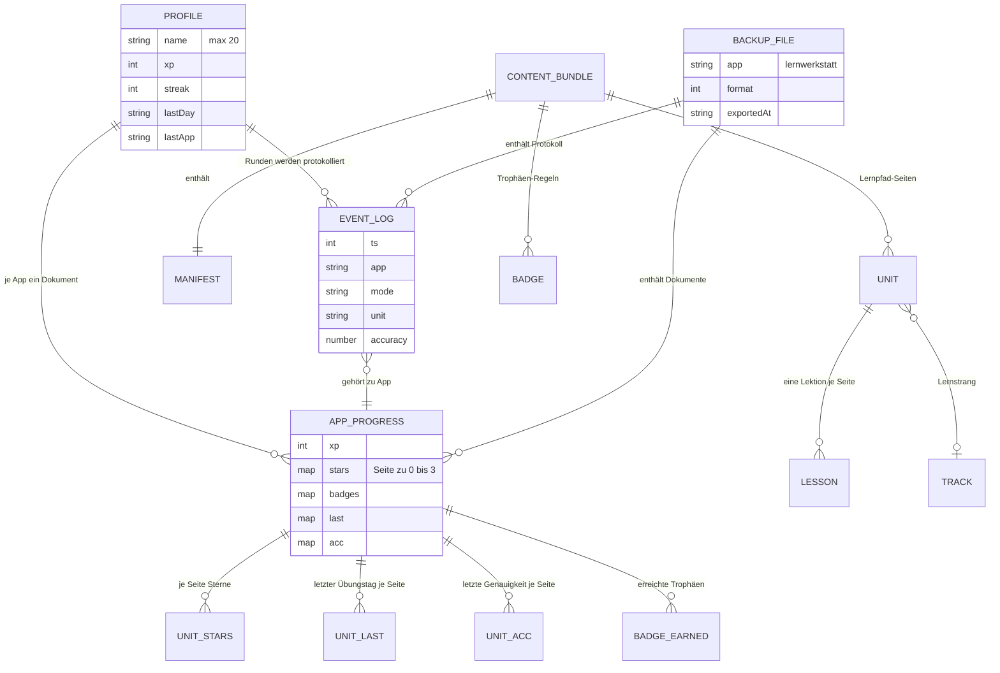

# Spezifikation: modulare (Quelle für den Neubau)

Stand: 2026-10-26. Quelle: Legacy-Code auf Branch `modernize/modulare` (Commit `1c7495d`), `BUSINESS_RULES.md` (286 Regeln), `RULE_REVIEWS.json` (103 Prüfungen), `topology.json`, `DATA_OBJECTS.md` (45 Objekte). Die Legacy-App ist Quelle der Spezifikation, nicht Vorlage für die Struktur.

Geltender Umfang für diesen Lauf: **Phase 1 des Briefs** (Spielregeln und gemeinsame Helfer). Die übrigen Fähigkeiten stehen für die späteren Phasen bereit.

Behandlung der Prüfungen: Eine Regel mit Urteil **Falsch** steht nicht als Spezifikation, sondern mit dem Zielverhalten aus `RULE_REVIEWS.json` (RULE-112, RULE-128). Eine Regel mit Urteil **Unsicher** ist eine offene Frage und keine Spezifikation (neun Stück, Brief §7).

---

## Fähigkeiten

Was das System leisten muss:

1. **Spielregeln:** XP vergeben, Level aus XP berechnen, Combo-Faktor bis ×4, Sterne aus Genauigkeit, Trefferquote nur aus Erstversuchen, Boss-Belohnung, Serie mit Gnadentag, Auffrischen fälliger Seiten, Empfehlung für die nächste Übung. (Regeln 061 bis 071, 172, 189, 194, 208, 242.)
2. **Runden:** Fragen nach Seite und Schwierigkeit erzeugen, Antworten prüfen (Auswahl, Eintippen, Zuordnen), zweiter Versuch für falsche Antworten, Herzen, Endgegner, Blitz. (Regeln 067, 069, 118, 137, 151, 165, 166, 229, 243.)
3. **Lernstand:** Profil und App-Stand speichern, nach Neustart wiederherstellen, unbekannte Felder erhalten, Standardwerte ergänzen, Zurücksetzen mit Bestätigung. (Regeln 133, 197, 205, 207, 247.)
4. **Inhalte:** Inhaltspaket als Ganzes prüfen, Materiallinks nur relativ, Lektion je Seite zeigen. (Regeln 143, 144, 222.)
5. **Sicherung:** Fortschritt und Ereignisprotokoll als Datei exportieren, nur eigene Dateien einspielen. (Regel 256.)
6. **Startseite und Ansichten:** alle Seiten zeigen, Endgegner sperren bis alle Seiten einen Stern haben, Name maskieren. (Regeln 206, 220, 242, 258.)

## Domänenmodell

Entitäten aus `DATA_OBJECTS.md`, Beziehungen aus dem Code:

Hinweis: `UNIT_STARS`, `UNIT_LAST`, `UNIT_ACC` und `BADGE_EARNED` sind Schlüssel-Wert-Felder in `APP_PROGRESS`. Sie stehen im Diagramm nur, damit Beziehungen sichtbar sind.

## Schnittstellen-Verträge

| Schnittstelle | Richtung | Form | Quelle | Status |
|---|---|---|---|---|
| IndexedDB `lernwerkstatt`, Sammlung `docs` | intern, lesen und schreiben | `{key, value, updatedAt}` | `core/js/db.js:17-74` | in Benutzung |
| IndexedDB `lernwerkstatt`, Sammlung `log` | intern, lesen und schreiben | `{id, app, …}`, max. 1000 bei Export | `core/js/db.js:18-22, 122` | in Benutzung |
| localStorage, Schlüssel `lernwerkstatt:profile` und `lernwerkstatt:app:<id>` | intern, nur lesen für Altstand | JSON mit `__v` | `core/js/store.js:24-59`, `core/js/profile.js:6-7` | Altstand, wird übernommen |
| Sicherungsdatei | extern (Datei herunter und hoch) | `{app, format: 1, exportedAt, docs, log}` | `core/js/db.js:117-142`, `core/js/views/backup.js` | in Benutzung |
| Inhaltspaket (JSON, statisch) | intern, lesen | `{manifest, lessons, badges, data}` | `content/<id>/*.json`, `schemas/bundle.schema.json` | in Benutzung |
| Inhalte-API (HTTP) | extern, lesen | `GET <base>/apps/<id>/content` mit Zugangsschlüssel | `core/js/content.js:34-41`, Meta-Tag `lw-content-api` in `core/js/boot.js` | vorbereitet, keine Gegenstelle im Repo |

Festlegung für den Neubau: Die IndexedDB-Datenbank `lernwerkstatt` mit den Sammlungen `docs` und `log` bleibt unverändert, damit der Lernstand aller Nutzerinnen und Nutzer erhalten bleibt. Gespeicherte IDs (App, Seiten, Trophäen, Schlüssel) werden nie umbenannt (`AGENTS.md`).

## Nichtfunktionale Anforderungen

- **Offline:** Die App läuft ohne Netz, wenn die Inhalte lokal liegen (Regel 185: letztes gespeichertes Paket bei Fehler).
- **Datenschutz:** Der Name steht nur im lokalen Speicher. Es gibt keine Übertragung an Dritte. Die Sicherungsdatei enthält den Namen (SEC-007, Entscheidung in Phase 4).
- **Barrierefreiheit und Bedienung:** Tastatur, sichtbarer Fokus, Touch-Ziele mindestens 44 px, hell und dunkel, `prefers-reduced-motion` (`AGENTS.md`, Abschnitt Design).
- **Sicherheit:** Keine Ausgabe ungeprüfter Daten ohne Maskierung (SEC-001, SEC-003). Materiallinks nur relativ (SEC-002). Eine Content-Security-Policy ohne `unsafe-inline` für Skripte (SEC-004).
- **Speicher:** Jeder Zugriff ist abgesichert, die App funktioniert auch ohne Speicher (Entscheidung in Frage 4 offen).
- **Größe:** Kein Laufzeitpaket außer React. Keine Analyse-Dienste, keine externen Skripte.
- **Umfang der Daten:** Eine Person pro Gerät. Ereignisprotokoll bis 1000 Einträge im Export.

## Verhaltensvertrag (Given/When/Then)

Die Regeln sind die Akzeptanztests. Der Vorschlag aus Brief §5 gilt nur, wenn die Person Frage 1 bestätigt. Bis dahin sind die Regeln aus dem Brief-Vorschlag **provisorisch**.

Phase 1 (Regeln in `core/js/profile.js`, `rounds.js`, `rules.js`):

- **RULE-061:** Given Profil mit XP. When Level berechnet wird. Then Stufe n wird erreicht, sobald XP ≥ 30·n·(n−1) ist, Stufe 1 bei 0 XP.
- **RULE-062:** Given Gutschrift von XP. When XP vergeben werden. Then steigen Profil-XP, App-XP und Tages-XP um den Betrag; Level-Aufstieg und Tagesziel werden gemeldet.
- **RULE-063:** Given aufeinanderfolgende richtige Antworten. When die Combo steigt. Then wächst der Faktor in Schritten bis höchstens ×4.
- **RULE-064:** Given eine beendete Lektionsrunde. When Sterne vergeben werden. Then 3 Sterne ab 90 %, 2 ab 70 %, sonst 1; gescheitert 0.
- **RULE-067:** Given Antworten in einer Runde. When Genauigkeit berechnet wird. Then zählen nur Erstantworten.
- **RULE-069:** Given Trefferzahl und fast richtige Antworten. When die Trefferquote berechnet wird. Then richtig + halb fast richtig, geteilt durch die Zahl der Originalfragen.
- **RULE-071:** Given Endgegner. When er gewonnen wird. Then 50 Bonus-XP und Trophäe; bei Niederlage nichts.
- **RULE-189:** Given gescheiterte Lektionsrunde. When abgeschlossen. Then keine Sterne, keine Perfekt-Trophäe.
- **RULE-194:** Given fällige Seite. When Lektionsrunde endet. Then Tag und Genauigkeit gespeichert; Auffrischen-Bonus 10 XP einmal.
- **RULE-208:** Given Übungstage. When der Tag wechselt. Then Serie +1 bei Folgetag, bleibt bei einem Gnadentag, Neustart nach längerer Pause.

Phase 2 bis 5 (Auszug, Details im Brief):

- **RULE-143:** Given Inhaltspaket. When eine Prüfung scheitert. Then wird das ganze Paket abgelehnt.
- **RULE-144:** Given Materiallink. When er geprüft wird. Then nur relative Pfade im Ordner `files/`.
- **RULE-197:** Given gespeicherter Fortschritt. When die App neu startet. Then ist er vorhanden; Zurücksetzen stellt die Standardwerte her.
- **RULE-207:** Given gespeicherter Stand mit unbekannten Feldern. When geladen. Then bleiben die Felder, neue Standardfelder kommen dazu.
- **RULE-256:** Given Sicherungsdatei. When eingespielt. Then nur Dateien mit `app: lernwerkstatt`; fremde Dateien werden abgelehnt.
- **RULE-243:** Given falsche Antwort. When die Runde endet. Then kommt die Frage einmal erneut, mit neu gemischten Antworten; nicht im Boss, nicht bei Zuordnungen.
- **RULE-151:** Given getippte Antwort. When geprüft. Then exakt richtig; „fast richtig“ nur bei abweichenden Akzenten.
- **RULE-166:** Given Auswahlfrage. When geprüft. Then richtig nur bei passender Option.
- **RULE-137:** Given Texteingabe. When verglichen. Then Groß/Klein, Apostroph und Leerzeichen vereinheitlicht.
- **RULE-165:** Given jede generierte Aufgabe. When geprüft. Then akzeptiert der Prüfer die eigene richtige Antwort.
- **RULE-229:** Given App-Rundengrößen. When eine Runde erzeugt wird. Then Lektion 8, Boss 12, Schnellrunde 5, Blitz nur Auswahl.
- **RULE-206:** Given Endgegner. When freigeschaltet. Then erst wenn jede Seite mindestens einen Stern hat.
- **RULE-195:** Given Rundenende. When es passiert. Then werden Ergebnis ausgewertet, gespeichert, protokolliert und angezeigt.
- **RULE-247:** Given beendete Runde. When gespeichert. Then Name, Punkte, Sterne gespeichert und mit App und Seite protokolliert.
- **RULE-133:** Given Zurücksetzen einer App. When ausgelöst. Then zwei Bestätigungen; Name und Gesamt-XP bleiben.
- **RULE-193:** Given Runde wird vorzeitig verlassen. When das passiert. Then bleibt die bereits verdiente XP erhalten, kein Rundenergebnis.

Nicht in den Vertrag aufgenommen (Begründung in Brief §5): RULE-150, RULE-160, RULE-186, RULE-187, RULE-202. Unsicher (offen): RULE-056, 075, 119, 125, 126, 135, 223. RULE-112 und RULE-128 sind entschieden (Urteil Falsch, Zielverhalten in `RULE_REVIEWS.json`).

## Befunde aus dem Schnittstellen-Katalog

Geprüft per Lesen und Grep (2026-10-26): 14 eingehende und 11 ausgehende Schnittstellen. Keine URL-Parameter, keine Cookies, kein postMessage, kein WebSocket, keine Drittanbieter-Hosts. Vorbereitet, aber nicht genutzt: Meta-Tag `lw-content-api`, HTTP-Quelle, Offline-Cache, `listEvents`.

Anforderungen aus dem Katalog für den Neubau:

- **Schreibfehler sichtbar machen:** `core/js/store.js:51` verschluckt Schreibfehler. Der Neubau meldet sie (Phase 2).
- **Altstand erst nach bestätigtem Schreiben entfernen:** `core/js/db.js:58` löscht den localStorage-Eintrag vor der IndexedDB-Bestätigung (Frage 3, RULE-187).
- **Protokoll begrenzen und vollständig sichern:** `core/js/db.js:62` kürzt das IndexedDB-Protokoll nie. Export nimmt nur die letzten 1000 (`db.js:122`). Der Neubau setzt eine Obergrenze und exportiert nachvollziehbar (Phase 2).
- **Einspielen atomar:** `core/js/db.js:68-71` (`logReplace`) leert und füllt in getrennten Transaktionen. Der Neubau nutzt eine Transaktion (Phase 2).
- **Dateigröße beim Einspielen begrenzen:** `core/js/views/backup.js:15` liest die ganze Datei ohne Grenze (Phase 4).
- **Name nicht unverschlüsselt exportieren:** `core/js/shell.js:122` und `core/js/db.js:122` schreiben den Namen in den Export. `AGENTS.md` sagt, der Name bleibt im lokalen Speicher (SEC-007, Entscheidung in Phase 4).

## Offen für Checkpoint 1

**Antwort der Person (Checkpoint 1):** Die P0-Liste aus Brief §5 gilt. Nichts wird gestrichen. Die Regeln aus §5 sind damit die Akzeptanztests des Verhaltensvertrags.
