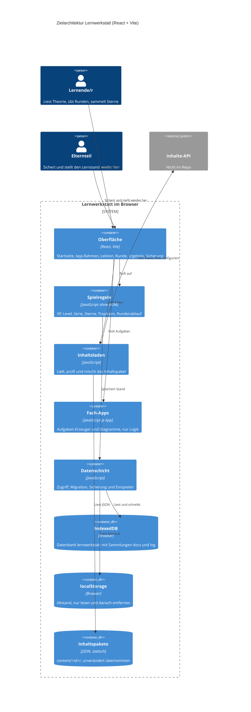
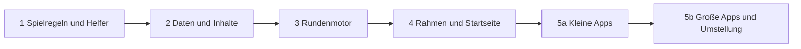

# Modernisierungsbrief: modulare

Stand: 2026-10-26. Ziel-Stack: **React + Vite** (aus `INTENT.md`). Modus: **Neu bauen**, Befehl pro Phase `reimagine`.

Eingaben und Zeitstempel (Lokalzeit):

| Eingabe | Stand | Inhalt |
|---|---|---|
| `INTENT.md` | 13:51 | Ziel, Stack, was gleich bleibt |
| `PREFLIGHT.md` | 13:56 | Antworten der Person, Scope-Grenze, Bereitschaft |
| `ASSESSMENT.md` | 14:04 | Schuld, Sicherheitsfunde, Empfehlung |
| `topology.json`, `call-graph.mmd`, `data-lineage.mmd`, `critical-path.mmd` | 14:16 bis 14:17 | 93 Knoten, 186 Kanten, 3 Abläufe |
| `BUSINESS_RULES.md`, `DATA_OBJECTS.md` | 14:53 | 286 Regeln: 215 P1, 71 P2, **0 P0** |
| `RULE_REVIEWS.json`, `RULE_REVIEWS.md` | 15:03 | 103 geprüft: 94 Richtig, 9 Unsicher, 0 Falsch |

Kein früherer Brief vorhanden. `DELTA_CATALOG.md` ist nicht nötig (kein Uplift).

---

## 1. Ziel

Die Lernwerkstatt (Vanilla JavaScript als ES-Module, fünf Fach-Apps plus Startseite, rund 4,7 KSLOC, keine Laufzeit-Abhängigkeiten) wird als React-App mit Vite neu gebaut. Ziele: modularer Aufbau, wiederverwendbare Komponenten, Datenschicht getrennt von Spielregeln, einfache und nachhaltige Architektur.

Warum jetzt: Die Ansichten sind HTML-Strings, die Rundenbausteine sind in jeder App kopiert, und die Speicherschicht kann Daten still überschreiben (Schuld 1 bis 3, SEC-001). Vorgaben aus der Vorprüfung: Das alte System läuft bis zur Umstellung weiter, bekannte Fehler werden mitbehoben, die Sicherheitsprüfung kommt zuerst.

---

## 2. Zielarchitektur



Festlegungen:

- Sprache bleibt JavaScript (ES-Module und JSX). TypeScript ist nach `AGENTS.md` ausgeschlossen.
- Laufzeit-Abhängigkeit: nur React. Build und Tests: Vite, sonst nichts neu (Test-Runner ist Frage 10).
- Apps importieren nur aus den gemeinsamen Schichten, nie voneinander.
- Gespeicherte IDs (App, Seiten, Trophäen, Schlüssel `lernwerkstatt:profile`, `lernwerkstatt:app:<id>`) bleiben unverändert.

Abbildung Legacy auf Ziel:

| Legacy (Dateien) | Ziel | Phase |
|---|---|---|
| `core/js/profile.js`, `rounds.js`, `rules.js` | Spielregeln, reine Module | 1 |
| `core/js/mathkit.js`, `ui.js`, `icons.js`, `mascot.js`, `confetti.js` | Gemeinsame Helfer; Zahlen und Eingabeprüfung als Module, Bilder und Figuren als Komponenten | 1 |
| `core/js/db.js`, `store.js` | Datenschicht (IndexedDB, Fallback, Migration, Sicherung) | 2 |
| `core/js/content.js`, `validate.js`, `appconfig.js` | Inhaltsladen und Paketprüfung | 2 |
| `core/js/quiz.js`, `qtypes.js`, `questions.js`, `blitz.js` | Rundenmotor und Fragetypen als Komponenten | 3 |
| `core/js/shell.js`, `boot.js`, `views/*.js` | App-Rahmen, Routen, Ansichten | 4 |
| `dashboard.js`, `registry.js` | Startseite, Liste der Apps aus Inhalten | 4 |
| `core/js/lesson.js`, `theory.js`, `svg.js`, `tracks.js` | Lektion und Theorie als Komponenten | 4 |
| `apps/<id>/builders.js`, `logic.js`, `numbers.js`, `math.js`, `geom.js`, `model.js` | Aufgaben-Erzeuger je App, rein logisch | 5a, 5b |
| `apps/<id>/diagrams.js` | SVG-Komponenten je App | 5a, 5b |
| `apps/<id>/theory.js` | Theorie-Spielzeug je App | 5b |
| `apps/<id>/main.js`, `index.html` | Einstieg und Route je App | 5a, 5b |
| `content/<id>/*.json` | unverändert übernommen | 2, 5a, 5b |
| `tests/*`, `scripts/smoke.mjs` | Tests je Schicht, Durchspiel über alle Apps | 1 bis 5b |

Schuld-Korrekturen im Zielbau: Debt 1 bis 3 und SEC-001 in Phase 2. Die gemeinsame Fabrik für Rundenbausteine (Debt 4) entsteht in Phase 3, die Apps nutzen sie ab Phase 5. Endlosschleife in den Erzeugern (Debt 6) und Konstanten (Debt 7) in den jeweiligen Apps. Sicherheitsfunde SEC-002 und SEC-003 in Phase 2, SEC-004 (Content-Security-Policy) in Phase 4, SEC-005 und SEC-006 in Phase 1 (Entwicklungs-Setup), SEC-007 in Phase 4 (Export).

---

## 3. Phasen

Reihenfolge nach Strangler-Fig: zuerst das Fundament ohne Oberfläche, dann Daten, Runde und Rahmen, zuletzt die Apps. Der Neubau läuft bis Phase 5b im Testbetrieb neben dem Altbestand. Die Umstellung erfolgt als Ganzes in Phase 5b (Koexistenz-Variante a, Checkpoint 2). Die Daten bleiben über die gesamte Umstellung lesbar, weil Phase 2 die alte Datenbank unverändert übernimmt.

Phase 1 ist der erste Durchlauf des Stacks. Was er zeigt (ein übersehenes Delta, eine Voraussetzung, die die Reihenfolge ändert, ein Umgebungsdetail), wird diesen Plan voraussichtlich ändern. Dann den Brief neu erzeugen. Das ist der Normalfall, kein Fehler. Pilot für die Apps: `apps/deutsch` als erste App in Phase 5a (Vorschlag, Frage 8).

Größe (S, M, L, XL) ist der Anteil an der Schlüsselwort-Zählung je Phase, nicht eine Dauer: S unter 15 %, M 15 bis 25 %, L 25 bis 40 %, XL über 40 %. Die Zählung nutzt dieselbe Methode wie das Assessment, Summe 1068 über alle Phasen inklusive Tests. Sie ist nicht identisch mit den 776 im Assessment.



#### Phase 1 — Spielregeln und gemeinsame Helfer

Status: abgenommen am 2026-10-26 durch die Person (Umfang Phase 1). Umsetzung: modernized/modulare-reimagined/regeln und helfer, 93 Tests grün. Rundung bei RULE-128 kaufmännisch bestätigt.

```text
Command: /code-modernization:modernize-reimagine
Modules: core/js/profile.js, core/js/rounds.js, core/js/rules.js, core/js/mathkit.js, tests/profile.test.js, tests/rounds.test.js, tests/helpers.js
Scale: S
Risk: mittel; Zahlen weichen beim Neuschreiben ab (Level 30·n·(n−1), Combo ×4, Sterne ab 70 und 90 %). Gegenmaßnahme: Charakterisierungstests gegen Legacy-Funktionen mit festen Eingaben. Zweitens: Spielregeln bekommen eine DOM-Abhängigkeit. Gegenmaßnahme: Test, der jedes Modul ohne document lädt.
Entry criteria:
- [x] Brief ist im Block in §8 freigegeben (Umfang Phase 1)
- [x] RULE-112 und RULE-128 (mathkit) entschieden und in RULE_REVIEWS.json eingetragen (Zielverhalten bestätigt)
- [x] Quelle entschieden: eigene Kopie unter legacy/modulare (Frage 7)
- [x] npm test und npm run smoke auf modernize/modulare grün, Zahlen in analysis/modulare/BASELINE.md festgehalten
Exit criteria:
- [x] Tests zu RULE-061, 062, 063, 064, 067, 069, 071, 189, 194 und 208 bestehen gegen die neue Logik (modernized/modulare-reimagined, 93 Tests grün)
- [x] Die Module profile, rounds, rules und mathkit laden ohne React und ohne document (Test) (regeln/tests/grenzen.test.js)
- [x] Die Scaffold-Tests in modernized/modulare-reimagined/regeln und helfer ersetzen die Legacy-Tests tests/profile.test.js und tests/rounds.test.js für diese Module. Die Legacy-Tests bleiben im Legacy-Klon als Vergleich (Revision angenommen)
- [x] SEC-005 und SEC-006 behoben: Server nur auf 127.0.0.1, Lockfile im Repo (im Legacy-Klon, noch nicht committet)
```

#### Phase 2 — Datenschicht und Inhalte

Status: abgenommen am 2026-10-26 durch die Person. Umsetzung: modernized/modulare-reimagined/speicher (35 Tests, Feldtypen 5 Tests) und inhalte (118 Tests), Gesamtsuite 254 grün. Annahmen bestätigt: Zugangsschlüssel als Authorization Bearer, ajv mit strict false. Offen aus der Abnahme: Browser-Test mit echter IndexedDB.

```text
Command: /code-modernization:modernize-reimagine
Modules: core/js/db.js, core/js/store.js, core/js/content.js, core/js/validate.js, core/js/appconfig.js, tests/db.test.js, tests/content.test.js, tests/core-content.test.js, ds:indexeddb, ds:localstorage, ds:content-api
Scale: S
Risk: hoch; Datenverlust beim Speichern und Einspielen (Schuld 1 bis 3, SEC-001). Gegenmaßnahme: eine Transaktion je Ersetzung, Rohdaten sichern bevor Standardwerte gelten, Typprüfung in der Einspielung. Zweitens: alter Stand wird nicht gelesen (Datenbank lernwerkstatt, Sammlungen docs und log, Schlüssel lernwerkstatt:app:<id>). Gegenmaßnahme: Lesetest mit einer echten Sicherung aus der Legacy-App, mit erfundenem Namen.
Entry criteria:
- [ ] Phase 1 erfüllt
- [x] RULE-125, RULE-126 und RULE-135 entschieden (Frage 2 in §7, nach Empfehlung bestätigt)
- [x] Frage 3 zur Entfernung des Altstands beantwortet (RULE-187, nach Empfehlung bestätigt)
- [ ] Fixture: eine Sicherungsdatei aus der Legacy-App, mit erfundenem Namen, außerhalb des Repos oder ohne echte Daten
Exit criteria:
- [x] Die neue Datenschicht liest Sicherung und Legacy-IndexedDB vollständig; ein Test vergleicht den Stand Feld für Feld (speicher/tests/legacy.test.js, 3 Tests grün)
- [x] Schuld 1, 2, 3 und SEC-001 je mit einem Test, der den alten Fehler nachstellt (rot vor dem Fix, grün danach)
  Stand: SCHULD-1, SCHULD-2, SCHULD-3 im Legacy-Code reproduziert (analysis/modulare/fixtures/repro/defects.repro.test.mjs). SEC-001: Feldtypen für Profil und App-Stand sind Pflicht (Entscheidung der Person) und umgesetzt (speicher/tests/schema.test.js, 5 Tests grün). Die Legacy-Lücke ist per Codelesen belegt (db.js:126-130 prüft nur Präfix und Objekt), nicht per Lauf.
- [x] SEC-002 und SEC-003 behoben: Verweise mit \ abgelehnt, Inhalte mit html und svg geprüft (inhalte/tests, 118 Tests grün)
- [x] Tests zu RULE-143, 144, 197, 207 und 256 bestehen (speicher und inhalte)
- [x] Jede Schreibaktion läuft in einer Transaktion (Test, schreiben.test.js und sicherung.test.js)
```

#### Phase 3 — Rundenmotor und Fragetypen

Entscheidung der Person: Der Endgegner kostet ein Herz, wie in Legacy (quiz.js:128). Umsetzung: modernized/modulare-reimagined/runde (65 Tests grün).
Status: abgenommen am 2026-10-26 durch die Person. Das Dual-Execution-Kriterium gilt in der Fassung der Proposed revision (Vergleich mit Legacy in Phase 5a).

```text
Command: /code-modernization:modernize-reimagine
Modules: core/js/quiz.js, core/js/qtypes.js, core/js/questions.js, core/js/blitz.js, tests/qtypes.test.js
Scale: M
Risk: mittel; Rundenablauf ändert sich unbemerkt (Herzen, zweiter Versuch, Combo, Boss). Gegenmaßnahme: Dual-Execution mit festem Seed gegen den Legacy-Lauf. Zweitens: Antwortprüfung weicht ab (Normalisierung, fast richtig). Gegenmaßnahme: Eigenschaftstests über alle Fragen.
Entry criteria:
- [ ] Phase 2 erfüllt
- [ ] Zufall ist testbar: Erzeuger bekommen Zufallsquelle oder Seed als Parameter (AGENTS.md)
- [ ] Keine offene Regel dieser Phase (Prüfung abgeschlossen)
Exit criteria:
- [ ] Tests zu RULE-243, 151, 166 und 137 bestehen
- [ ] Legacy und neuer Lauf liefern bei gleichem Seed dieselbe Fragenfolge und dieselben Punkte (Test)
  Proposed revision: Der Legacy-Lauf ist DOM-gebunden (quiz.js rendert). Ersatz in Phase 3: Regeltests mit festen Antworten (RULE-243, 151, 166, 137, 193) und Herzen-Test. Der Vergleich mit dem Legacy-Lauf folgt in Phase 5a, wo echte Apps laufen.
- [ ] Die gemeinsame Fabrik für Rundenbausteine existiert (Schuld 4); die Apps nutzen sie noch nicht
```

#### Phase 4 — App-Rahmen, Startseite und Lektionen

```text
Command: /code-modernization:modernize-reimagine
Modules: core/js/ui.js, core/js/icons.js, core/js/mascot.js, core/js/confetti.js, core/js/shell.js, core/js/boot.js, core/js/views/home.js, core/js/views/result.js, core/js/views/backup.js, core/js/lesson.js, core/js/theory.js, core/js/svg.js, core/js/tracks.js, dashboard.js, registry.js, scr:index.html, tests/views.test.js, tests/pages.test.js, tests/registry.test.js
Scale: S
Risk: mittel; die Startseite bleibt leer, wenn der Speicher fehlt (Schuld 8, RULE-202 im Widerspruch zu AGENTS.md). Gegenmaßnahme: Fehlerpfad mit Meldung, Entscheidung in Frage 4. Zweitens: Sicherung in der Oberfläche verliert Funktion. Gegenmaßnahme: Abnahmeliste für Sicherung und Einspielen.
Entry criteria:
- [ ] Phase 3 erfüllt
- [x] RULE-075 entschieden (Frage 2): erledigt ab 2 von 3 Sternen, Fortschritt in Prozent
- [x] Frage 4 zu RULE-202 beantwortet: ohne Speicher leerer Stand mit Meldung, kein Abbruch
Exit criteria:
- [x] Tests zu RULE-195, 247, 133 und 193 bestehen (Gesamtsuite 482 grün, 2026-10-26)
- [x] Startseite zeigt alle Seiten, sperrt den Endgegner bis alle Seiten einen Stern haben, maskiert den Namen (Tests, Browserlauf: „Hallo, •••!“)
- [x] Hell, dunkel und 375 px Breite ohne horizontales Scrollen, Ergebnis in analysis/modulare/UAT_P4.md (hell und dunkel geprüft)
- [x] Tastatur bedienbar, Fokus sichtbar, Touch-Ziele mindestens 44 px (Browserlauf 2026-10-26: Tab-Reihenfolge, 3 px Fokusrahmen, alle Ziele 44 px hoch)
- [x] SEC-004 umgesetzt: Content-Security-Policy in der index.html (Seite lädt unter der CSP)
- [x] SEC-007 entschieden und umgesetzt (Name im Export): Name bleibt in der Sicherung, mit Hinweis am Knopf (Empfehlung der Person gefolgt)
- [x] Streak beim Verlassen einer Runde zählt (Entscheidung der Person, RULE-208)
```

#### Phase 5a — Kleine Fach-Apps (Pilot: deutsch)

```text
Command: /code-modernization:modernize-reimagine
Modules: apps/_template/builders.js, apps/_template/diagrams.js, apps/_template/logic.js, apps/_template/main.js, apps/deutsch/builders.js, apps/deutsch/diagrams.js, apps/deutsch/logic.js, apps/deutsch/main.js, apps/geometrie/builders.js, apps/geometrie/diagrams.js, apps/geometrie/geom.js, apps/geometrie/logic.js, apps/geometrie/main.js, scr:apps/_template/index.html, scr:apps/deutsch/index.html, scr:apps/geometrie/index.html, tests/deutsch.test.js, tests/geometrie.test.js, ds:content:vorlage, ds:content:deutsch, ds:content:geometrie
Scale: S
Risk: mittel; die vorlage wird zum Vertrag für neue Apps, ein Fehler dort zieht alle Apps mit. Gegenmaßnahme: Vorlage zuletzt ändern, Vertragstest. Zweitens: Endlosschleife in den Erzeugern (Schuld 6, geometrie/builders.js). Gegenmaßnahme: Obergrenze mit Fehlermeldung und Test.
Entry criteria:
- [x] Phase 4 erfüllt (abgenommen 2026-10-26)
- [x] RULE-223 entschieden (Frage 2): wie beschrieben, bestätigt im Chat am 2026-10-26
- [x] Pilot bestätigt: deutsch zuerst (Frage 8)
Exit criteria:
- [x] deutsch läuft in der neuen App; Legacy und neu liefern bei gleichem Seed dieselben Fragen und Punkte (Fragen: 3600 Vergleiche ohne Abweichung, analysis/modulare/dual/deutsch_dual.mjs. Punkte: Herzen, XP und Combo als Konstanten gegen quiz.js geprüft, kein Legacy-Lauf des Rundenmotors, weil er DOM-gebunden ist)
- [x] Tests zu RULE-165 und RULE-229 bestehen für deutsch und geometrie (apps/deutsch/tests, apps/geometrie/tests)
- [x] Erzeuger in geometrie mit Versuchsobergrenze und Fehlermeldung (Schuld 6): MAX_TRIES = 200, danach RangeError, die Seite zeigt "Die Aufgaben konnten nicht erzeugt werden."
- [x] Die Vorlage apps/_template ist auf die neue Architektur umgestellt und besteht den Vertragstest (apps/_template/tests/vertrag.test.js)
```

Status: Phase 5a freigegeben am 2026-10-26 durch die Person. Umsetzung: modernized/modulare-reimagined/apps (deutsch, geometrie, _template), Verdrahtung in seiten/rahmen.js (Theorie vor der Übung, Runden mit Zufall von außen). Abgenommen am 2026-10-26 durch die Person. Blitz ist noch nicht an den Rahmen gebunden (Phase 5b).

#### Phase 5b — Große Fach-Apps und Umstellung

```text
Command: /code-modernization:modernize-reimagine
Modules: apps/mathe/builders.js, apps/mathe/diagrams.js, apps/mathe/logic.js, apps/mathe/main.js, apps/mathe/math.js, apps/informatik/builders.js, apps/informatik/diagrams.js, apps/informatik/logic.js, apps/informatik/main.js, apps/informatik/numbers.js, apps/informatik/smoke.mjs, apps/informatik/theory.js, apps/franzoesisch-verben/builders.js, apps/franzoesisch-verben/diagrams.js, apps/franzoesisch-verben/logic.js, apps/franzoesisch-verben/main.js, apps/franzoesisch-verben/model.js, apps/franzoesisch-verben/smoke.mjs, apps/franzoesisch-verben/theory.js, scr:apps/mathe/index.html, scr:apps/informatik/index.html, scr:apps/franzoesisch-verben/index.html, tests/mathe.test.js, tests/informatik.test.js, tests/french.test.js, tests/contract.test.js, scripts/smoke.mjs, ds:content:mathe, ds:content:info-zahlen, ds:content:fr-verben
Scale: L
Risk: hoch; größte Logik im Repo (mathe/builders.js mit 291 Zeilen) und die Umstellung selbst. Gegenmaßnahme: Antwortprüfung je Aufgabenpool als Test, Dual-Execution je App. Zweitens: Pfade brechen oder Stand geht bei der Umstellung verloren (Seiten liegen unter /lernapp-sira/). Gegenmaßnahme: relative Pfade in Vite-Build prüfen, Sicherung vor dem Umzug.
Entry criteria:
- [x] Phase 5a erfüllt (abgenommen 2026-10-26)
- [x] RULE-056 und RULE-119 entschieden (Frage 2): RULE-056 Mittel der beiden mittleren Werte, RULE-119 nur richtig oder falsch
- [x] Frage 5 zur Veröffentlichung beantwortet: GitHub Pages aus dist/
Exit criteria:
- [x] Alle fünf Apps laufen in der neuen Architektur; Smoke über alle Live-Apps grün (apps/tests/smoke.test.js). Umsetzung in analysis/modulare/UAT_P5B.md
- [x] RULE-165 und RULE-206 bestehen als Tests für mathe, info-zahlen und fr-verben
- [x] Dual-Execution für jede App: gleiche Seeds, gleiche Fragen wie im Legacy-Lauf. deutsch, info-zahlen, fr-verben: 0 Abweichungen. mathe: alle Abweichungen durch RULE-056 (gerade Anzahl im Median-Pool), siehe UAT_P5B.md. Punkte über Konstanten.
- [x] Sicherung aus der Legacy-App vor dem Umzug in die neue App eingespielt; Stichprobe des Stands stimmt (Browser, Fixture)
- [ ] Veröffentlichung über GitHub Pages aus dist/ läuft; die Legacy-Dateien werden erst nach Freigabe entfernt (offen: Freigabe für Push und Merge nach main)
- [x] AGENTS.md und README an den neuen Aufbau angepasst
```

---

## 4. Business Walkthroughs

Persona **Lernende oder Lernender der 7. Klasse**, Ablauf „Eine Übungsrunde spielen“:

| Schritt | Was passiert | Legacy-Module | Ersetzt in Phase |
|---|---|---|---|
| Startseite öffnen | Kacheln aller Fächer, Vorschlag zum Üben | `dashboard.js`, `registry.js` | 4 |
| App starten und Inhalte laden | Fach-Seite lädt ihre Aufgaben und Lektionen | `apps/mathe/main.js`, `core/js/boot.js`, `content/mathe` | 2 (Laden), 5b (App) |
| Frage beantworten, Runde auswerten | Herzen, Combo, zweiter Versuch, Ergebnis | `core/js/shell.js`, `quiz.js`, `qtypes.js` | 3, 4 |
| Punkte und Stand speichern | XP, Sterne, Serie und Protokoll werden gesichert | `core/js/profile.js`, `store.js`, `db.js` | 1 (Regeln), 2 (Speicher) |

Persona **Lernende oder Lernender, die oder der eine Seite zum ersten Mal lernt**, Ablauf „Theorie lesen und Mini-Check machen“:

| Schritt | Was passiert | Legacy-Module | Ersetzt in Phase |
|---|---|---|---|
| Lektion öffnen | Erklärung, Analogie, Mini-Check | `core/js/shell.js`, `theory.js`, `lesson.js` | 4 |
| Bild der Seite ansehen | Diagramm zur Seite | `apps/mathe/diagrams.js`, `core/js/svg.js` | 5b (Diagramm), 4 (SVG-Hilfe) |

Persona **Elternteil, das den Lernstand sichert**, Ablauf „Lernstand sichern“:

| Schritt | Was passiert | Legacy-Module | Ersetzt in Phase |
|---|---|---|---|
| Sicherung erstellen | Datei mit allen Daten herunterladen | `core/js/shell.js`, `views/backup.js`, `db.js` | 4 (Oberfläche), 2 (Daten) |
| Daten aus dem Browser lesen | Stand aus IndexedDB lesen | `ds:indexeddb` | 2 |

---

## 5. Behavior Contract

**Befund:** Keine Regel ist als P0 eingestuft. Die Extraktion vergab 0 P0. 16 Regeln waren im Zwei-Richter-Panel gespalten, ob sie für den Kernzweck nötig sind, und blieben deshalb P1.

**Vorschlag (noch nicht bindend, Frage 1):** Die folgenden Regeln als P0 führen. Jede ist von der Person als **Richtig** bestätigt. Sie müssen in der angegebenen Phase als Test gegen die neue Umsetzung bestehen, bevor die Phase abgeschlossen werden kann.

| Regel | Titel | Phase |
|---|---|---|
| RULE-061 | Level-Schwelle aus gesammelten XP | 1 |
| RULE-062 | XP-Gutschrift: Profil, App, Tagesziel und Level-Aufstieg | 1 |
| RULE-063 | Combo-Faktor bis ×4 | 1 |
| RULE-064 | Sterne aus der Genauigkeit einer abgeschlossenen Runde | 1 |
| RULE-067 | Genauigkeit zählt nur Erstversuche | 1 |
| RULE-069 | Trefferquote einer Runde | 1 |
| RULE-071 | Boss: 50 Bonus-XP und Trophäe nur bei Sieg | 1 |
| RULE-189 | Gescheiterte Lektionsrunde gibt keine Sterne und keine Perfekt-Trophäe | 1 |
| RULE-194 | Abschluss einer Lektionsrunde: Tag, Genauigkeit, Auffrischen-Bonus | 1 |
| RULE-208 | Serie: Folgetag, Gnadentag, Neustart, Verfall | 1 |
| RULE-143 | Inhaltspaket als Ganzes prüfen, halb kaputte App startet nicht | 2 |
| RULE-144 | Materiallinks nur als sichere relative Pfade | 2 |
| RULE-197 | Gespeicherter Fortschritt bleibt nach Neustart erhalten | 2 |
| RULE-207 | Unbekannte Felder bleiben, neue Standardfelder kommen dazu | 2 |
| RULE-256 | Sicherung enthält alle Daten, Einspielen lehnt fremde Dateien ab | 2 |
| RULE-243 | Zweiter Versuch: falsche Frage kommt am Rundenende zurück | 3 |
| RULE-151 | Getippte Antwort: exakt richtig, fast richtig nur bei Akzenten | 3 |
| RULE-166 | Auswahlfrage richtig nur bei passender Option | 3 |
| RULE-137 | Texteingabe vor dem Vergleich vereinheitlicht | 3 |
| RULE-195 | Rundenabschluss wertet aus, speichert, protokolliert und zeigt Ergebnis | 4 |
| RULE-247 | Profil und App-Stand nach jeder Runde gespeichert und protokolliert | 4 |
| RULE-133 | Zurücksetzen einer App braucht zwei Bestätigungen | 4 |
| RULE-193 | XP bleibt erhalten, wenn eine Runde vorzeitig verlassen wird | 4 |
| RULE-165 | Jede Aufgabe akzeptiert ihre eigene richtige Antwort | 5a, 5b |
| RULE-229 | Rundengrößen: Lektion 8, Boss 12, Schnellrunde 5, Blitz nur Auswahl | 5a, 5b |
| RULE-206 | Endgegner freigeschaltet, wenn alle Seiten einen Stern haben | 5b |

**Nicht aufgenommen:**

- RULE-187 und RULE-202: bestätigt, stehen aber im Widerspruch zu `AGENTS.md` und Schuld 8. Entscheidung in Frage 3 und Frage 4.
- RULE-150: die Notiz der Prüfung zu ignorierten Einheiten ist offen.
- RULE-160: die Notiz vermutet einen Fehler im Test selbst.
- RULE-186: Konfidenz niedrig, Test-Name widersprüchlich.
- Neun Unsicher-Regeln: in §7 als offene Fragen, Phasen-Sperren siehe §3.

---

## 6. Validation Strategy

| Phase | Verfahren |
|---|---|
| 1 | Charakterisierungstests gegen Legacy-Funktionen mit festen Eingaben; Modul-Test ohne DOM |
| 2 | Lesetest mit echter Sicherung und Legacy-IndexedDB (Fixture, erfundener Name); Regressionstest je Schuld 1 bis 3 und SEC-001; Transaktionstest |
| 3 | Dual-Execution mit festem Seed; Eigenschaftstests über alle Fragen; Vertragstests für Fragetypen |
| 4 | Komponententests für Ansichten; manuelle Abnahme: hell, dunkel, 375 px, Tastatur (UAT_P4.md) |
| 5a | Dual-Execution für deutsch und geometrie; Vertragstest der Vorlage |
| 5b | Dual-Execution je App; Antwortprüfung je Pool (RULE-165); Durchspiel über alle Apps; Stichprobe des Stands nach Einspielen der Sicherung; Pfadprüfung im Vite-Build unter /lernapp-sira/ |

Über alle Phasen: `npm test` und `npm run smoke` grün vor jedem Commit (AGENTS.md). Die Legacy-Tests bleiben bis zur Umstellung in 5b, damit der Vergleich möglich ist.

---

## 7. Open Questions

Jede Frage braucht eine Entscheidung vor der genannten Phase.

1. [ ] Behavior Contract: die Liste in §5 als P0 führen, ja, nein oder mit Änderungen?
2. [ ] Die neun Unsicher-Regeln (Phasen-Sperren in §3):
   - [ ] RULE-112 (Phase 1): Wahrscheinlichkeit als Bruch, Dezimalzahl oder Prozent richtig, Zahl ohne Prozentzeichen falsch. Gewollt?
   - [ ] RULE-128 (Phase 1): Gerundete Antwort (0,333 für 1/3) richtig? Falls ja, braucht die Prüfung eine Toleranz.
   - [ ] RULE-125 (Phase 2): Soll die Inhalte-API bei der Umstellung den Adressaufbau `…/apps/<id>/content` behalten?
   - [ ] RULE-126 (Phase 2): Soll Einspielen den Ereignis-Log ersetzen oder zusammenführen, und vorher nachfragen?
   - [ ] RULE-135 (Phase 2): Unlesbarer Stand fällt auf Standardwerte zurück. Gewollt, oder Rohdaten sichern und melden (Schuld 1)?
   - [ ] RULE-075 (Phase 4): Eine Seite gilt als erledigt ab einem Stern, der Fortschritt wird in Prozent angezeigt. Gewollt?
   - [x] RULE-223 (Phase 5a): Auswahlfragen mit richtiger Antwort und höchstens drei falschen, zufällig sortiert. Gewollt? Entschieden im Chat am 2026-10-26: wie beschrieben.
   - [ ] RULE-119 (Phase 5b): Eingabe nach Bereinigung gleich dem Ergebnis gilt als richtig, nur richtig oder falsch, keine Teilpunkte. Gewollt?
   - [ ] RULE-056 (Phase 5b): Gibt es Datenreihen mit gerader Anzahl Werte? Falls ja, soll der Median das Mittel der beiden mittleren Werte zeigen?
3. [ ] RULE-187 (Phase 2, bestätigt): Soll der Altstand im localStorage erst nach erfolgreichem Schreiben in IndexedDB entfernt werden? Empfehlung: ja (behebt Schuld 2).
4. [ ] RULE-202 (Phase 4, bestätigt): Die Startseite zeichnet ohne Speicher nichts. AGENTS.md verlangt Lauffähigkeit ohne Speicher. Empfehlung: Startseite zeigt mit leerem Stand und Meldung.
5. [ ] Veröffentlichung (Phase 5b): GitHub Pages veröffentlicht dist/ aus Vite-Build (Empfehlung), oder ein anderer Weg?
6. [ ] Sicherheitsprüfung: Der Scan im Assessment ist erledigt (SEC-001 bis SEC-007). `harden` ist nicht gelaufen. Reicht der Scan, oder vor Phase 1 `harden` laufen lassen?
7. [ ] Quelle `legacy/modulare` (Preflight Check 7): Symlink auf das Arbeits-Repo lassen, oder eigene Kopie anlegen? Entscheidung vor Phase 1.
8. [x] Pilot: deutsch als erste App in Phase 5a (Vorschlag), entschieden im Chat am 2026-10-26.
9. [ ] Gespeicherte IDs (App, Seiten, Trophäen, Schlüssel) bleiben unverändert, wie in AGENTS.md. Bestätigen (Preflight-Hinweis).
10. [ ] Test-Runner: node:test beibehalten (kein neues Paket), oder Vitest als neue Dev-Abhängigkeit?
11. [ ] Schuld 1 bis 3 und SEC-001 sind Pflicht-Anforderungen des Umbaus, nicht Übernahme des Alten (Empfehlung: ja).
12. [ ] Offen aus der Vorprüfung: CI-Dauer nachtragen (blockiert nichts).

---

## 8. Approval Block

```
Approved by: Freigabe im Chat durch die Person (Name nicht eingetragen)  Date: 2026-10-26
Approval covers: Phase 1 only
```

Steuerung des Plans: Die Build-Befehle lesen die Kriterien in den Phasen-Blöcken als verbindlich. Sie dürfen Kästchen abhaken oder Notizen anfügen, aber nie einen Kriterientext umformulieren. Vorschläge zur Änderung stehen auf einer Zeile `Proposed revision:` für die freigebende Person. **Geändert wird der Plan, indem diese Datei bearbeitet wird.** Ein Chat-Hinweis ändert nichts.
