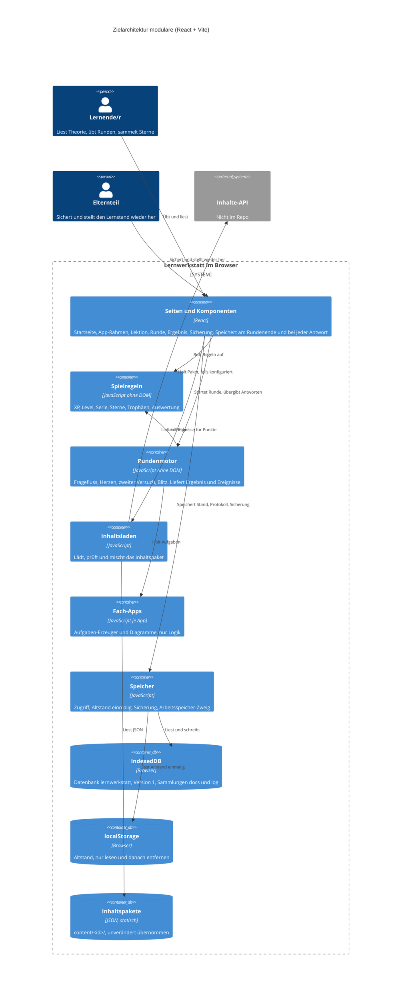

# Zielarchitektur: modulare neu (React + Vite), überarbeitet nach Kritik

Stand: 2026-10-26. Quellen: `AI_NATIVE_SPEC.md` (Checkpoint 1: P0-Liste aus Brief §5 gilt), `MODERNIZATION_BRIEF.md` (§2 Architektur, §3 Phasen), `INTENT.md` (Ziel React + Vite), Kritik des architecture-critic (Gesamturteil: sound with changes).

## Was sich gegenüber dem Entwurf ändert

| # | Kritik | Entscheidung in dieser Fassung |
|---|---|---|
| 1 | Koexistenz auf gleichem Ursprung nicht geregelt | Abschnitt „Koexistenz“ neu. Umstellungsvariante ist Checkpoint-2-Frage. |
| 2 | `spielregeln` importiert `store.js` (`profile.js:3`) | Phase 1 trennt reine Funktionen von `openProfile`/`openApp`. Letztere wandern in Phase 2 nach `speicher`. Import-Test in Phase 1. |
| 3 | `runde` ändert Zustand mitten im Lauf (`quiz.js:23, 84, 172`, `blitz.js:4`) | `runde` liefert Ergebnis und Ereignisse ohne Speicherzugriff. Der Rahmen speichert. Regel 193 (XP bleibt bei frühem Verlassen) wird über ein Ereignis je Antwort abgedeckt. |
| 4 | Speicher-frei-Betrieb ist nur eine offene Frage | Pflicht laut AGENTS.md. Speicher-Hülle hat einen Arbeitsspeicher-Zweig. Test startet die App ohne Speicher. Offen bleibt nur der Wortlaut der Meldung. |
| 5 | Echte Sicherung als Testfixture widerspricht dem Brief | Testfixture wird per Skript mit erfundenem Namen erzeugt. Echte Sicherung nur manuell außerhalb des Repos, festgehalten wird nur bestanden oder nicht. |
| 6 | Zu viele Schichten für eine kleine App | Flache Struktur (siehe unten), kein `index.js`-Gateway pro Modul, DOM-Helfer nach Phase 4. Ein Import-Test mit etwa 30 Zeilen erzwingt die Grenzen. |
| 7 | Offene Entscheidungen als gesetzt formuliert | Frage 3 steht als Eingangsbedingung für Phase 2. Protokoll-Obergrenze wird Phase-2-Eingangsbedingung. Reihenfolge Löschen erst nach Commit ist Testanforderung. |
| 8 | Gate auf nicht bestätigte Urteile; RNG erst in Phase 3 | RULE-112 und RULE-128 brauchen Bestätigung (Checkpoint 2). Zufall wird in Phase 1 injizierbar gemacht. |

## Form

Keine Dienste, keine Server. Die Lernwerkstatt ist eine einzige Single-Page-App. Der Quellbaum ist flach und nach Schicht geordnet:

```
src/
  lib/          reine Logik, ohne React und ohne DOM
    regeln/     Punkte, Level, Serie, Sterne, Trophäen (Phase 1)
    helfer/     Zahlen- und Texteingabe, Zufall mit Seed (Phase 1)
    runde/      Rundenfluss als reine Funktionen, Fragetypen (Phase 3)
    speicher/   IndexedDB, Altstand, Sicherung, Arbeitsspeicher-Zweig (Phase 2)
    inhalte/    Paketladen und Prüfung (Phase 2)
  components/   wiederverwendbare Bausteine: Lektion, SVG, Icons, Maskottchen, Konfetti, Knöpfe (Phase 4)
  pages/        Startseite, App-Rahmen, Ergebnis, Sicherung (Phase 4)
  apps/<id>/    eine Fach-App: Aufgaben-Erzeuger und Diagramme (Phase 5a, 5b)
content/        Inhaltspakete, unverändert übernommen
```

Grenzen, vom Test erzwungen (ein `node:test`, Import-Scan über `src/`):

- `lib/regeln` importiert nicht aus `lib/speicher`, `components`, `pages`, `apps` und nicht aus React.
- `lib/runde` importiert nicht aus `components`, `pages` und `apps`.
- `lib/speicher` ist der einzige Ort mit Zugriff auf `indexedDB` und `localStorage`.
- `apps/<id>` importiert nicht aus anderen `apps/`.
- `lib/*` importiert nicht aus `components` oder `pages`.

Test-Runner: `node:test`, kein neues Paket (Frage 10 offen).

## Container



## Modulgrenzen mit Begründung

| Modul | Enthält (Legacy) | Regeln | Entitäten | Warum hier |
|---|---|---|---|---|
| `lib/regeln` | reine Teile von `profile.js` (Level, Serie, Tagesziel, Fälligkeit), `rounds.js` (Auswertung), `rules.js` (Trophäen) | 061 bis 071, 172, 189, 194, 208, 242 | PROFILE, APP_PROGRESS (Werte) | Reine Funktionen. Ein Fehler wirkt auf alle Apps. Ohne Speicher testbar. |
| `lib/helfer` | `mathkit.js` (Zahl, Bruch, Prüfung), Zufall mit Seed (neu) | 112, 128, 137 | Prüfer-Vertrag | Gemeinsam für alle Apps. Zufall ist injiziert, damit Tests deterministisch laufen. |
| `lib/runde` | `quiz.js`, `qtypes.js`, `questions.js`, `blitz.js` (ohne Speicherzugriff) | 067, 069, 118, 151, 165, 166, 193, 229, 243 | Rundenzustand, Frage, Optionen | Reine Übergänge. Fragetypen sind Plug-ins wie heute. |
| `lib/speicher` | `db.js`, `store.js`, `openProfile`/`openApp` aus `profile.js`, Sicherung aus `views/backup.js`-Logik | 186, 187, 197, 207, 256 | Speicher-Hülle, Sicherungsdatei, Ereignis-Log | Einziger Zugang zu IndexedDB und localStorage. Schreibfehler werden gemeldet. Arbeitsspeicher-Zweig bei Ausfall. |
| `lib/inhalte` | `content.js`, `validate.js`, `appconfig.js` | 143, 144, 185 | Inhaltspaket, Manifest, Lektion | Prüft das Paket als Ganzes, bevor eine App startet. |
| `components` | `ui.js`, `icons.js`, `mascot.js`, `confetti.js`, `lesson.js`, `svg.js`, `tracks.js`, `theory.js` | 220 | Lektion, Diagramm | DOM-nahe Bausteine. Erst in Phase 4, weil Phase 1 kein DOM braucht. |
| `pages` | `shell.js`, `boot.js`, `views/*`, `dashboard.js`, `registry.js` | 133, 195, 202, 206, 247 | Seiten, Ergebnis, Sicherung | Verbindet Regeln, Runde und Speicher. Keine eigene Logik. |
| `apps/<id>` | `builders.js`, `diagrams.js`, `logic.js`, `numbers.js`, `math.js`, `geom.js`, `model.js`, `theory.js` | 165, 223 (Vorlage), 229 | Aufgabe, Diagramm | Ein Ordner je App. Inhalt kommt aus `content/`. |

## Technikwahl (je eine Zeile Begründung)

- **React:** Vorgabe aus `INTENT.md`. Komponenten für Seiten und Bausteine.
- **Vite:** Build und Entwicklungsserver. Ergebnis ist ein statischer Ordner `dist/` für GitHub Pages.
- **Hash-Routing (`#/app/mathe`):** Die App liegt unter `/lernapp-sira/`. Hash-Routen brechen beim Neuladen nicht und brauchen keinen Server-Rewrite.
- **Relative Pfade (`base: './'`):** `AGENTS.md` verlangt relative Pfade.
- **Kein Zustands-Framework:** React-Zustand reicht für Profil und App-Stand.
- **Keine neue Laufzeit-Abhängigkeit außer React:** `AGENTS.md`. Der Speicher nutzt die bestehende IndexedDB-API ohne Bibliothek.
- **Tests:** `node:test` für Regeln, Runde, Speicher, Inhalte und den Import-Test. DOM-Tests für Komponenten erst in Phase 4 (Frage 10 offen).
- **TypeScript: nein.** `AGENTS.md`.

## Koexistenz mit der Legacy-App

Alte und neue App liegen auf demselben Ursprung und teilen sich die Datenbank `lernwerkstatt` in Version 1 (`legacy/modulare/core/js/db.js:7,30`). Zwei Schreiber auf denselben Schlüsseln ergeben „letzter Schreiber gewinnt“. Das ist nicht akzeptabel.

Regel für den Neubau:

- Die neue Version öffnet die Datenbank in Version 1 und hebt die Version nicht an, solange die Legacy-App erreichbar ist.
- Jede Änderung am Schema ist erst nach Abschalten der Legacy-App zulässig.
- Der Neubau bietet Testbetrieb an, bis die Umstellung entschieden ist. Die Legacy-App bleibt unter ihrer Adresse erreichbar.

Entscheidung für Checkpoint 2 (Varianten):

- **(a) Empfehlung:** Neubau nur im Testbetrieb (eigener Pfad, gleiche Datenbank, nur lesen oder im Testprofil). Umstellung als Ganzes in Phase 5b. Einfacher und ohne Zwei-Schreiber-Fall. Abweichung vom Strangler-Fig-Plan des Briefs.
- **(b)** Apps einzeln umziehen. Dafür braucht es eine Schreibsperre für `lernwerkstatt:profile` in der alten Version. Die alte App wird dafür verändert, das ist ein Eingriff in den Bestand.

## Datenmigration

Kein Umzug. Der neue Speicher liest und schreibt dieselbe Datenbank mit denselben Sammlungen (`docs`, `log`) und Schlüsseln (`lernwerkstatt:profile`, `lernwerkstatt:app:<id>`). Sicherungsdateien bleiben im Format 1.

Eingangsbedingungen für Phase 2 (aus der Kritik):

- Frage 3 entschieden: Altstand im localStorage wird erst nach bestätigtem Schreiben entfernt. Test prüft die Reihenfolge.
- Protokoll: kein Kürzen im Export. Entschieden (Checkpoint 2, bestätigt): der Export nimmt alle Einträge. Größe wird beim Einspielen geprüft. Legacy-Kürzung auf 1000 (`db.js:122`) entfällt.
- Schreibweg: eine Transaktion je Ersetzung (Schuld 2).
- Einspielen: Typprüfung, Größengrenze, Protokoll wird nicht stillschweigend ersetzt (Schuld 3, SEC-001).

Prüfung:

- Testfixture: per Skript erzeugte Sicherung mit erfundenem Namen, im Repo.
- Echte Sicherung aus der Legacy-App: manuell außerhalb des Repos eingespielt. Festgehalten wird nur „bestanden“ oder „nicht bestanden“, ohne Inhalte.

## Phase 1 im Rahmen dieser Architektur

Phase 1 baut `lib/regeln`, `lib/helfer` und den Testrahmen mit Import-Test. Kein Speicherzugriff, kein DOM. Die Legacy-App bleibt unverändert lauffähig.

Änderungen gegenüber dem Brief (brauchen Freigabe, siehe Checkpoint 2):

- `ui.js`, `icons.js`, `mascot.js` und `confetti.js` wandern aus Phase 1 in Phase 4 (`components`). Sie sind DOM-nah und haben in Phase 1 keine Abnahme.
- `profile.js` wird geteilt: reine Teile in Phase 1, `openProfile`/`openApp` in Phase 2.

Zufall: `helfer` nimmt den Zufall als Parameter entgegen (Seed-fähig). Phase 1 nutzt das für die Charakterisierungstests.

Eingangstor: `analysis/modulare/BASELINE.md` (122 Tests, 332 Prüfungen grün).
Ausgangstor: die P0-Regeln aus Brief §5 für Phase 1 (061, 062, 063, 064, 067, 069, 071, 189, 194, 208) bestehen als Tests gegen die neue Logik. Zusätzlich besteht der Import-Test.

Hinweis zu Bestand: Das Assessment nennt RULE-112 und RULE-128 als „Falsch“ (Zielverhalten in `RULE_REVIEWS.json`). Brief-Kopf nennt noch „0 Falsch“ und ist damit veraltet.

## Checkpoint 2: Entscheidungen für die Person

1. **Architektur** in dieser Fassung freigeben (flache Struktur, Grenzen, Import-Test).
2. **Koexistenz:** Variante (a) Testbetrieb und Umstellung als Ganzes (Empfehlung) oder (b) Apps einzeln mit Schreibsperre.
3. **Brief-Änderung:** `ui.js`, `icons.js`, `mascot.js`, `confetti.js` aus Phase 1 nach Phase 4 verschieben (Empfehlung).
4. **RULE-112 und RULE-128:** Zielverhalten nach Schulstandard bestätigen. Text in `RULE_REVIEWS.json` (`Entscheidung delegiert`).
5. Später, aber vor Phase 2: Obergrenze des Protokolls festlegen (Vorschlag 1000).
